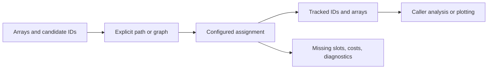
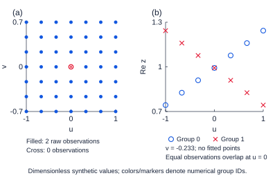

# Eigenmode Analysis

[English](README.md) · [简体中文](README.zh-CN.md) · [Synthetic gallery](docs/assets/showcase/gallery.html) · [Public API](docs/public-api.md)

Track eigenmode candidates without losing their identity or hiding missing samples. Array-based path and directed-graph tracking exposes assignment costs, coverage, rejected candidates and graph diagnostics.


**Computed synthetic demonstration.** Both panels contain the same 265 observations; eight missing slots remain missing. Colors denote numerical tracks, not unique physical mode identities. [Source](examples/synthetic_tracking.py) · [Provenance](docs/assets/showcase/manifest.json).

## Capabilities

| Capability | Public interface | Application |
|---|---|---|
| Ordered scans | `CandidateSet`, `TrackingConfig`, `track_path` | Reordered candidates, crossing branches and missing observations |
| Parameter graphs | `TraversalEdge`, `rectilinear_traversal`, `track_graph` | Explicit traversal, incoming-edge diagnostics and empty sites |
| Field and mode analysis | `symmetry`, `polarization`, `topology`, `propagation` | Reusable numerical operations on arrays |
| Sampling and characterization | `grid_sampling`, `lineshapes`, `peak_tracking`, `field_regimes` | Analysis independent of readers and rendering |

Runtime dependencies are NumPy and SciPy. The numerical package does not import plotting backends, DataFrames, simulator APIs or consumers. Callers own readers, physical selection, output paths and interpretation.



## Release lines and installation

| Public branch | Version | Compatibility |
|---|---|---|
| Default: `public-release` | **0.2.10** | Stable path/graph API; compatible with Plot Workflows 0.1.7 |
| `feature/band-tracking-v2` | **0.3.1** | Adds opt-in `band_grouping`; outside Workflows 0.1.7's `<0.3` requirement |

This checkout describes both lines. The gallery runs against the **0.2.10 wheel**, and does not validate the separate grouping algorithm. Python 3.10+ and Git are required for this pinned public-source install; no package-index release or version tag is assumed.

```bash
python -m venv .venv
# Activate .venv for your shell, then:
python -m pip install "eigenmode-analysis @ git+https://github.com/Patr1ck2005/eigenmode-analysis.git@e172495aa0c561cf0edf251ae9828dd5e54d2d64"
python -m pip check
```

A verified local `eigenmode_analysis-0.2.10-py3-none-any.whl` is also suitable. Stable consumers should install wheels rather than inject sibling-source paths.

## Complete small example

```python
import numpy as np
from eigenmode_analysis.tracking import CandidateSet, TrackingConfig, track_path

t = np.linspace(-1, 1, 21)
points = []
for i, value in enumerate(t):
    order = [1, 0] if i % 2 else [0, 1]
    values = np.array([1 + 0.2 * value, 1 - 0.2 * value])
    points.append(CandidateSet(order, values[order, None]))
result = track_path(points, coordinates=t,
                    config=TrackingConfig(n_tracks=2, derivative_weights=2))
assert result.coverage == 1.0
print(result.features.shape)  # (21, 2, 1)
```

Candidate IDs are opaque and local to each site. Feature scaling and continuity assumptions affect assignment; cost is not probability. Missing or rejected assignments remain `None`/NaN rather than silently becoming another mode.

## Computed examples

| Crossing and missing samples | Directed-graph diagnostics |
|---|---|
|  |  |

[Path-cost diagnostic](docs/assets/showcase/path-diagnostics.png) · [Offline PNG/SVG gallery](docs/assets/showcase/gallery.html).

From this repository, install the example's rendering dependency and run:

```bash
python -m pip install "plot-foundation @ git+https://github.com/Patr1ck2005/plot-foundation.git@c3d3cc23b2bb4da7ade7e5edf553d4a36d19db7f"
python examples/synthetic_tracking.py --out docs/assets/showcase
```

The fixed-seed example uses public APIs and independently defined mathematics. Assertions check observation preservation, the expected crossing, eight missing slots, an empty graph site and input-order invariance. PNG/SVG exports, the HTML gallery and manifest record source hashes, versions, dimensions and checks.

## Advanced grouping in 0.3.1

Install this line in its own environment, outside a stable Plot Workflows environment:

```bash
python -m venv .venv-grouping
# Activate .venv-grouping for your shell, then:
python -m pip install "eigenmode-analysis @ git+https://github.com/Patr1ck2005/eigenmode-analysis.git@d82251086f50cb1428c35f457631f74c10b5afc2"
python examples/synthetic_grouping.py --out .local/advanced-grouping
```



The [standalone script](examples/synthetic_grouping.py) defines a shuffled 7 × 7 grid of dimensionless complex values, `z = 1 ± 0.25u + 0.03v + 0.02i`, with one empty site. All **96 observations** retain their `(site, local_index)` identity, original IDs, payload and source values. Six sites contain two equal-frequency observations each; both copies remain distinct. The SVG shows observed support and one constant-v section, with no fitted or interpolated samples.

The run writes raw/grouped CSVs, an assignment table, original-row triangles, full diagnostics and a manifest to a fresh output directory. [Preview data and diagnostics](docs/assets/grouping-example/manifest.json) record package **0.3.1** and algorithm **stable-v1.0.0** separately. Assertions check observation preservation, multiplicity, missing support and unchanged source bytes; they do not certify a unique physical identity. Diagnostics remain `conditional_or_provisional`, with no calibrated probability. Only NumPy, SciPy and the standard library are required.

Read the [grouping contract](docs/band-grouping.md), including 1D explicit-seed restrictions and unresolved-case diagnostics. Do not implicitly upgrade a `<0.3` workflow environment.

## Documentation and development

[Public API](docs/public-api.md) · [Architecture](docs/architecture.md) · [Changelog](CHANGELOG.md) · [Agent rules](AGENTS.md) · [Four-library example](https://github.com/Patr1ck2005/plot-workflows#run-the-end-to-end-example).

For package development, use an isolated environment, install `.[dev]`, and run `python -m pytest -q`. Example assertions cover less than the complete package suite.

[Original collection concept artwork](docs/assets/portfolio/scientific-tools-research-v2.png), [grouping concept artwork](docs/assets/portfolio/band-grouping-research-v2.png) and [artwork provenance](docs/assets/portfolio/manifest.json) remain auxiliary illustrations, not computed results. MIT licensed; these examples make no experimental, full-wave or unpublished-research claim.
