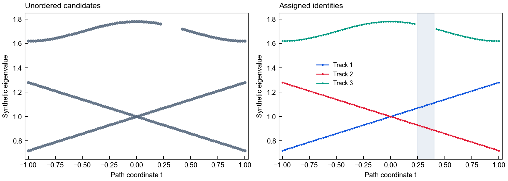
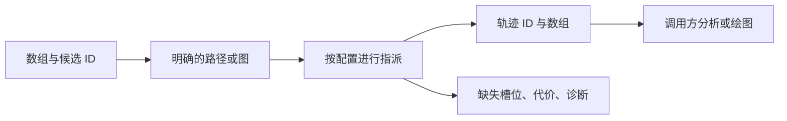
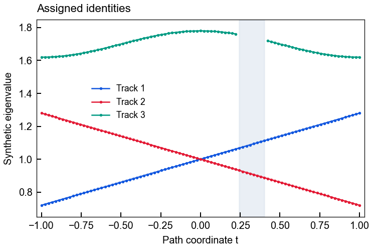
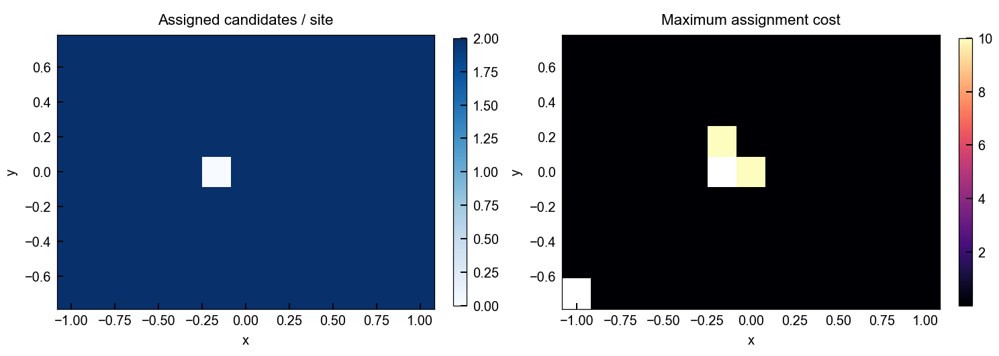

# Eigenmode Analysis

[English](README.md) · [简体中文](README.zh-CN.md) · [合成图集](docs/assets/showcase/gallery.html) · [公开 API](docs/public-api.md)

跟踪本征模候选，保留原始身份与缺失样本。基于数组的路径／有向图跟踪明确返回指派代价、覆盖率、被拒候选和图诊断。



**实际计算的合成示例。** 两图包含相同的 265 个观测；8 个缺失槽位仍然缺失。颜色表示数值轨迹，不代表唯一物理模式身份。[源码](examples/synthetic_tracking.py) · [来源记录](docs/assets/showcase/manifest.json)。

## 主要能力

| 能力 | 公开接口 | 用途 |
|---|---|---|
| 有序扫描 | `CandidateSet`、`TrackingConfig`、`track_path` | 候选重排、分支交叉和观测缺失 |
| 参数图 | `TraversalEdge`、`rectilinear_traversal`、`track_graph` | 明确遍历、入边诊断与空站点 |
| 场与模式分析 | `symmetry`、`polarization`、`topology`、`propagation` | 数组上的可复用数值运算 |
| 采样和特征分析 | `grid_sampling`、`lineshapes`、`peak_tracking`、`field_regimes` | 分析独立于读取和渲染 |

运行依赖为 NumPy、SciPy。数值库不导入绘图后端、DataFrame、仿真器 API 或消费端。读取、物理筛选、输出路径与解释属于调用方。



## 发行线与安装

| 公开分支 | 版本 | 兼容关系 |
|---|---|---|
| 默认 `public-release` | **0.2.10** | 稳定路径／图 API，兼容 Plot Workflows 0.1.7 |
| `feature/band-tracking-v2` | **0.3.1** | 新增可选 `band_grouping`，不满足 Workflows 0.1.7 的 `<0.3` 约束 |

本页是默认稳定发行文档。图集使用 **0.2.10 wheel**，不作为另一分组算法的验证。下面的固定公开源码安装需要 Python 3.10+ 和 Git，不假定存在包索引发行或版本标签。

```bash
python -m venv .venv
# 按当前 shell 的方法激活 .venv，然后执行：
python -m pip install "eigenmode-analysis @ git+https://github.com/Patr1ck2005/eigenmode-analysis.git@e172495aa0c561cf0edf251ae9828dd5e54d2d64"
python -m pip check
```

也可安装已核验的本地 `eigenmode_analysis-0.2.10-py3-none-any.whl`。稳定消费端应安装 wheel，不注入兄弟仓库源码路径。

## 可直接运行的简例

```python
import numpy as np
from eigenmode_analysis.tracking import CandidateSet, TrackingConfig, track_path

t = np.linspace(-1, 1, 21)
points = []
for i, value in enumerate(t):
    order = [1, 0] if i % 2 else [0, 1]
    values = np.array([1 + 0.2 * value, 1 - 0.2 * value])
    points.append(CandidateSet(order, values[order, None]))
result = track_path(points, coordinates=t,
                    config=TrackingConfig(n_tracks=2, derivative_weights=2))
assert result.coverage == 1.0
print(result.features.shape)  # (21, 2, 1)
```

候选 ID 是站点内的不透明标记。特征尺度与连续性假设会影响指派；代价不是概率。缺失或被拒的指派保留为 `None`／NaN，不静默替换成另一个模式。

## 实际生成的功能示例

| 交叉和缺失样本 | 有向图诊断 |
|---|---|
|  |  |

[路径代价诊断](docs/assets/showcase/path-diagnostics.png) · [离线 PNG／SVG 图集](docs/assets/showcase/gallery.html)。

在本仓库中安装示例绘图依赖并运行：

```bash
python -m pip install "plot-foundation @ git+https://github.com/Patr1ck2005/plot-foundation.git@c3d3cc23b2bb4da7ade7e5edf553d4a36d19db7f"
python examples/synthetic_tracking.py --out docs/assets/showcase
```

示例使用固定种子、公开 API 和独立数学定义。断言检查观测保留、预期交叉、8 个缺失槽位、空网格站点及输入顺序不变性。PNG／SVG、HTML 图集与 manifest 记录源码哈希、版本、尺寸及检查结果。

## 独立进阶分组线

0.3.1 位于独立的公开 feature 分支。采用前请阅读其[分组合同](https://github.com/Patr1ck2005/eigenmode-analysis/blob/feature/band-tracking-v2/docs/band-grouping.md)；不要隐式升级要求低于 0.3 版本的工作流环境。

## 文档与开发

[公开 API](docs/public-api.md) · [架构](docs/architecture.md) · [变更记录](CHANGELOG.md) · [Agent 规则](AGENTS.md) · [四库示例](https://github.com/Patr1ck2005/plot-workflows#run-the-end-to-end-example)。

开发使用隔离环境，安装 `.[dev]` 并运行 `python -m pytest -q`。示例断言覆盖范围小于完整包测试。

采用 MIT 许可证；示例不声称构成实验、全波或未公开研究成果。
